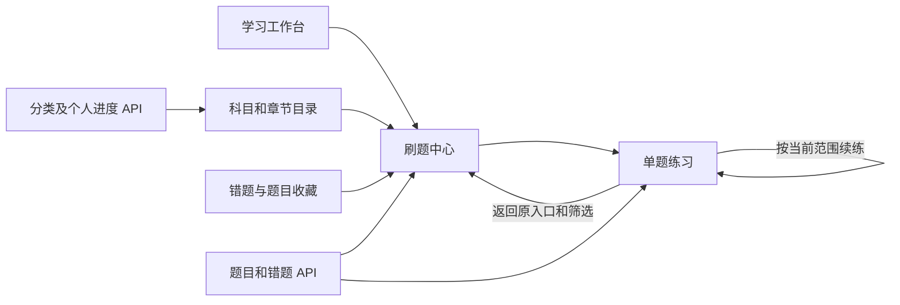

# 刷题模块重构方案

基线为知岸 `6cce700`，参考本地 `kaogong-shuati` 的 `12cf8e7`。方案日期为 2026-11-16。

## 参考做法与重构范围

参考项目在首页提供科目入口，科目页按模块和知识点展示题量、已做和正确率，用户选定范围后连续练习。可对照 `public/app.js` 的 `renderSubject`、`renderPractice`，以及 `server.mjs` 的章节查询和错题分组。

知岸当前只在列表中用扁平下拉框表示分类，数据库中的 `parentId` 未用于练习范围。题目列表和单题页各自拼接参数，返回时丢失原筛选，错题续练也没有沿用掌握状态和更新时间。重构从工作台入口到练习、错题和题目收藏这条链路，继续使用 Vue、Hono、PostgreSQL 和既有登录鉴权。题库内容继续来自知岸的演示数据与合法导入流程。参考仓库的题库、配图、AI、离线存储和 Android 应用不属于本次范围。

## 数据与 API

- 保留 `GET /api/v1/question-categories` 公开响应及现有分类查询语义。增加需登录的 `GET /api/v1/question-categories/progress`，从分类、启用题目及当前用户的练习记录集合查询各分类直接挂载的题量和进度，返回扁平分类记录。
- `count` 是启用题数，`attempted` 是至少练习过一次的去重题数，`attempts` 和 `correctAttempts` 是练习次数和答对次数。正确率按答对次数除以练习次数计算。模拟考试继续计入原有学习统计。父分类展示本级和后代合计，前端汇总计数后计算正确率。
- `GET /questions` 和 `GET /wrong-questions` 增加可选 `includeDescendants=true`。与 `categoryId` 一起使用时包含本级及所有后代，默认仍精确查询分类。查询只接受合法 UUID，递归以分类主键去重。父子关系保留来源于管理端的既有配置。
- 单题续练沿用现有 `after` 游标。错题续练将 `mastered` 和 `since` 传给 `/questions?mode=wrong`，服务端与错题列表共享用户、掌握状态和更新时间谓词。错题列表的排序用于浏览，续练按题目的稳定顺序向后推进。随机模式继续使用现有随机规则。
- API 只读查询复用现有表和索引，本次无需数据库迁移、重新导入或重置数据。同步 OpenAPI 和生成客户端。

## 页面与模块边界

- 在刷题中心提供按根分类科目分组的章节目录，并读取已有父子关系。平级分类作为独立章节展示。选择章节会进入对应范围，包含下级的入口明确展示其汇总进度。错题与收藏保留各自筛选和操作入口。
- 把学习路由状态、练习 API 调用和章节目录展示集中到 `features/practice`。将已提交的分类、关键词、模式、年份、掌握状态、更新时间、排序和页码放入 URL。由同一份范围构造列表请求、单题链接、续练和返回位置。保留旧的入口路径和 `categoryId` 深链接。
- 章节目录失败时提供局部重试，题目列表仍可加载。将选项、解析、笔记、收藏和答题历史沿用既有题目流程。界面沿用知岸的排版、色板和交互组件，移动端保证目录、进度和题目操作可用。

## 执行和验收

1. 落地分类进度、后代范围与错题公共筛选，更新 API 契约。
2. 接入目录、URL 范围和题目返回路径，工作台快捷入口按根分类汇总题量和开启相同练习范围。
3. 针对父子分类、停用题、重复作答、跨用户隔离、筛选返回和错题续练增加回归断言。运行类型检查、Lint、现有单测、隔离 PostgreSQL 集成测试、浏览器 E2E 和生产构建。

以工作区代码和隔离环境完成本次验收。代码可直接随原有流程构建，回退应用版本无需回退数据库。

## 实施验收

| 验证 | 本地结果 |
| --- | --- |
| `pnpm typecheck`、`pnpm lint` | 通过 |
| `pnpm test` | 12 项单元和组件测试通过 |
| `pnpm test:integration` | 14 项通过，使用独立 PostgreSQL 16 测试库 |
| `PLAYWRIGHT_CHANNEL=chrome pnpm test:e2e` | 2 项通过，覆盖筛选恢复、续题、章节进度和 375 px 移动端 |
| `pnpm build` | Web 和 API 构建通过，原有图表分包体积告警仍出现 |

本次验收在本地工作区完成。线上发布及生产数据联调另行执行。
